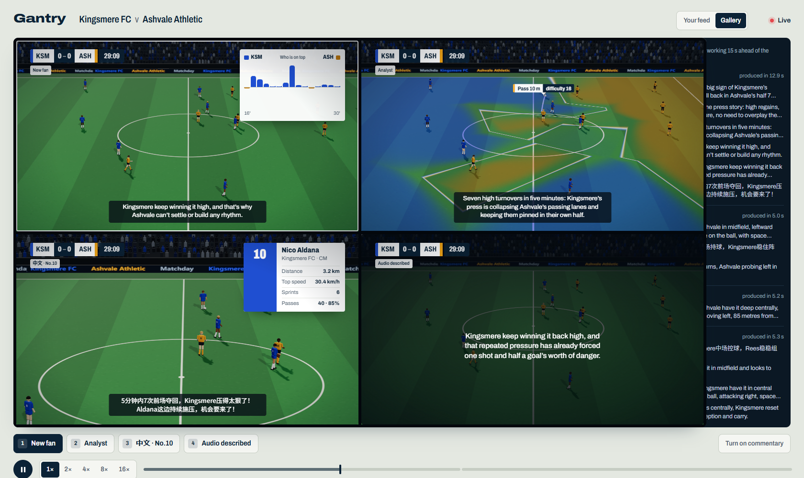
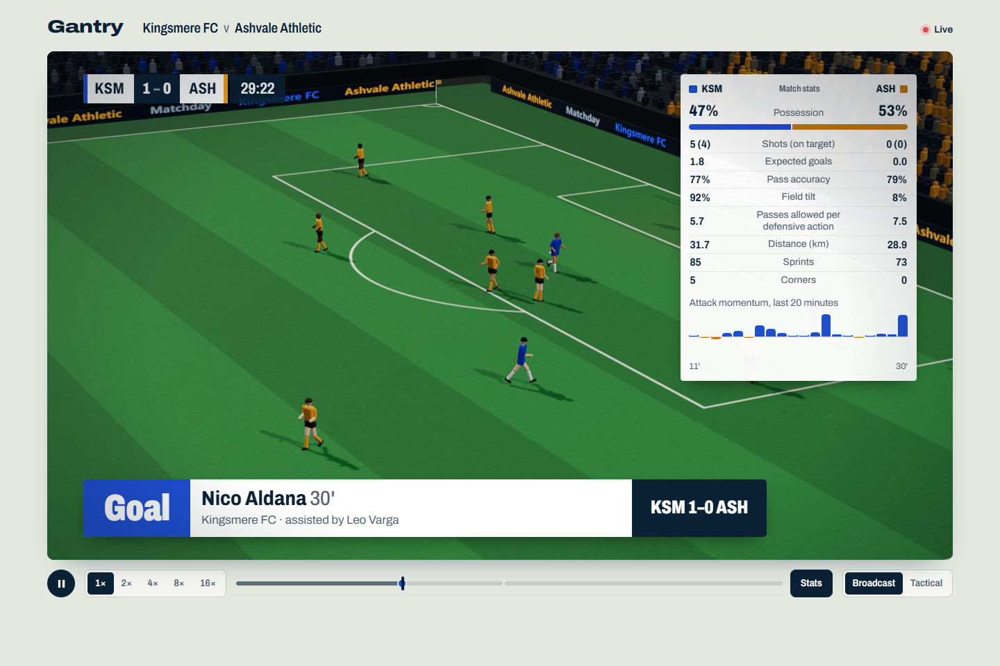
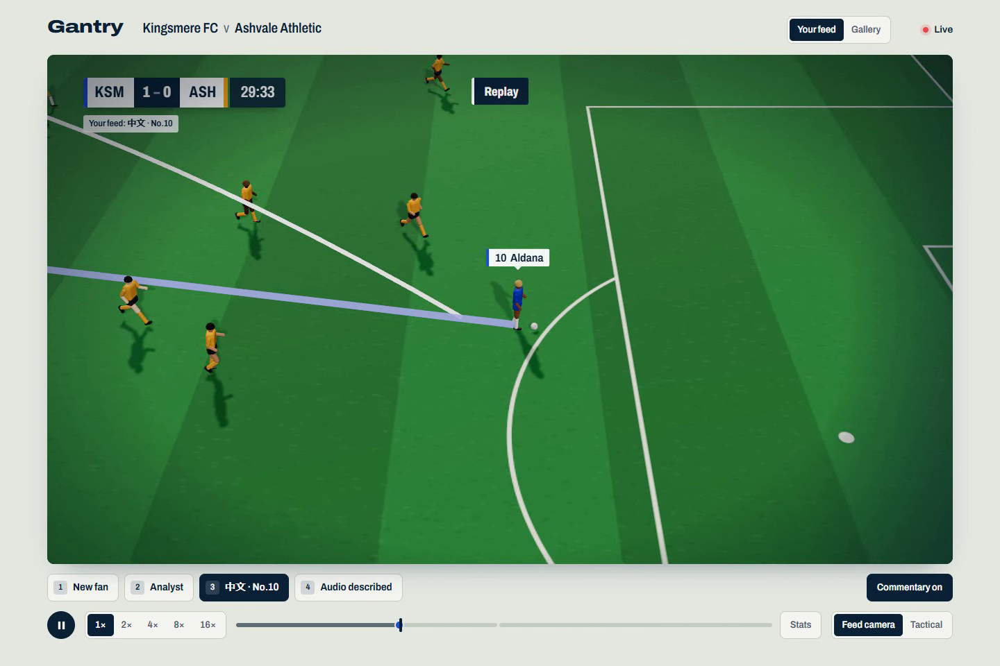
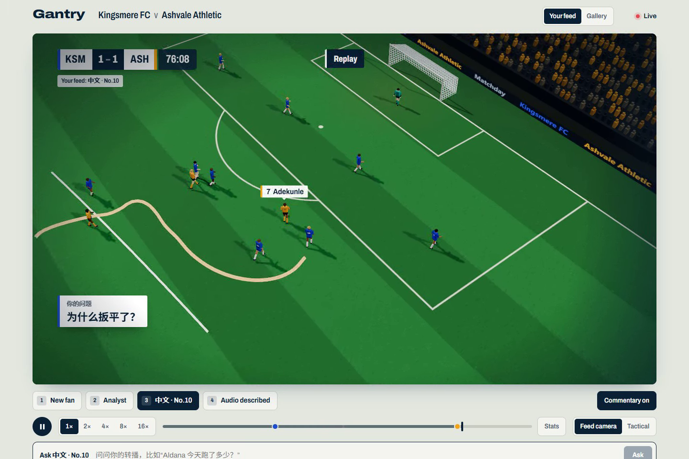
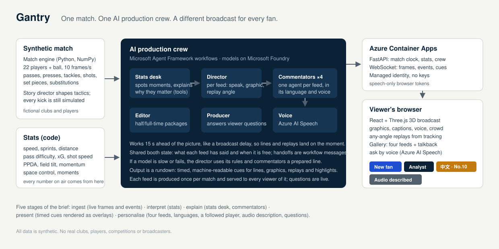

# Gantry

**One match. One AI production crew. A different broadcast for every fan.**

Gantry gives every fan their own live football broadcast. An AI production crew built with
Microsoft Agent Framework and Microsoft Foundry watches a synthetic match through full player
tracking and produces a separate feed for each kind of viewer — its own camera, graphics,
replays, language and voice — while a broadcaster's gallery sees every feed being made at once.



*The same second, four broadcasts. New fan: a "who is on top" chart and plain-words commentary.
Analyst: the space each team controls, painted on the grass, and the difficulty of the last pass.
Chinese, following No. 10: a camera on Nico Aldana and his player card. Audio described: the
picture dimmed, the words large. On the right, the crew's talkback.*

> Live demo and video: links are added at submission.

---

## Who it is for

Broadcasters and streaming platforms carry one match to millions of people who want different
things from it. Today a match gets a handful of commentary tracks, made by scarce people.
Gantry's crew makes as many feeds as there are audiences:

| Feed | Who it's for | What changes |
|---|---|---|
| **New fan** (English) | people new to football | big graphics, few numbers, why a moment matters |
| **Analyst** (English) | data-minded fans, coaches | pass difficulty, xG, pressing, space control drawn on the pitch |
| **中文 · No. 10** (Chinese) | overseas fans of the home side | a camera that follows their favourite player, his live numbers, a partisan voice |
| **Audio described** (English) | blind and partially sighted fans | where the ball is, who has it, which way they attack; the voice moves left and right with the ball |

Any viewer can **ask their broadcast a question**, typed or spoken — *"Why did Ashvale equalise?"* —
and the crew answers on their feed with a replay of the moment and a spoken reply in their language.

## What it does

- **Watches live.** A match clock streams 22 players and the ball at 10 frames a second, plus every
  event, over a WebSocket. The crew works 15 seconds ahead of the picture, like a broadcast delay,
  so commentary and replays land exactly on the moment.
- **Interprets.** Code computes everything that is ever said as a number: speed and sprints, distance,
  pass difficulty, shot speed and xG, PPDA, field tilt, attack momentum, and which team controls each
  patch of grass.
- **Explains.** The stats desk agent turns a moment into *why it matters* — "seven ball wins in
  Ashvale's half in five minutes", "an interception turned into a four-pass goal in 13 seconds".
- **Presents.** The crew's output is a rundown: timed, machine-readable cues for lines, graphics,
  replays and highlight packages. The browser renders them over a floodlit 3D broadcast.
- **Personalises.** Four feeds with their own camera, graphics, language, voice and point of view;
  questions answered for one viewer.

| | |
|---|---|
|  |  |
| Goal card, live score bug and the analyst's data panel. | An any-angle replay: the director picked a camera that follows Aldana, and his run is drawn as it happens. |
|  |  |
| "为什么扳平了?" — the producer replays Adekunle's run and answers in Chinese. | How it fits together. |

## The AI production crew

The crew is organised like a real broadcast team. Each role is an executor in a **Microsoft Agent
Framework** workflow; the agents run on **Microsoft Foundry** (gpt-5.4-mini); voices come from
**Azure AI Speech**.

| Role | Does | How |
|---|---|---|
| **Stats desk** | spots the moments worth talking about and explains why they matter | detection in code; an agent with tools over the match statistics writes the explanation |
| **Director** | decides, feed by feed, whether to speak, which graphic to put up and which replay angle to use | an agent returning a structured plan; its own rules when the model is slow |
| **Commentators** (one per feed) | write the line in the feed's language, style and point of view | four agents, called in parallel |
| **Voice** | reads every line in the feed's own voice | Azure AI Speech neural voices, an excited sports-commentary style in Chinese |
| **Editor** | cuts the half-time and full-time highlights and writes each feed's report | its own workflow, running alongside the live crew so a long edit never holds up the show |
| **Producer** | answers viewers' questions | an agent with tools that only see what the viewer has already seen, no spoilers |

The members share a booth — what each feed has said, when it is next free, what is on screen —
and hand work to one another as workflow messages. Every handoff appears in the gallery's talkback.

**When things go wrong the show goes on.** Every model call has a deadline. If the director can't
answer in time it falls back to its rules; if a commentator can't, a prepared line in the right
language goes out; a stalled voice falls back to captions; a moment that takes too long is dropped
rather than allowed to hold up the next.

**Produce once, serve many.** As a broadcaster would, each feed is produced once per match and every
later viewer of that feed receives that production. The demo match has been produced in full — 457
moments, 1,274 lines (94% written live by the models, the rest prepared lines used when a model was
slow), two highlight packages. Questions are always answered live.

## Synthetic data

There is no real data anywhere in Gantry. The match comes from a simulator written for it:

- **Engine** (Python, NumPy): two fictional clubs, Kingsmere FC and Ashvale Athletic, in 4-3-3 and
  4-2-3-1. A team shape that slides with the ball, a press that closes down and screens, man-marking
  near goal, runs in behind the line, recovery runs, tackles, fouls, set pieces, substitutions and
  fatigue. Every on-ball choice is scored as *how likely it is to work* × *how dangerous the place it
  gets us*.
- **Story director:** for the demo, a script shapes each side's tactics — Kingsmere press high early,
  Ashvale change shape after an hour and counter — and decides in which windows a shot may go in.
  Every pass, tackle and shot is still played out by the engine. The demo match (seed 60) finishes
  Kingsmere 2–1 Ashvale: Aldana 29', Adekunle 74', Bankole 90+2'.
- **Output:** 57,601 frames of tracking data and about 3,300 events, saved as NumPy and JSON. The demo
  match is in `backend/data/matches/demo`.

## Microsoft technologies used

- **Microsoft Foundry** — model deployments (gpt-5.4-mini) and the project the crew's agents run in.
- **Microsoft Agent Framework** (Python) — the crew and editor workflows, executors and message
  handoffs, tools for the stats desk and producer, structured outputs for the director and editor.
- **Azure AI Speech** — four neural voices with SSML styles for commentary; speech recognition for
  spoken questions, using short-lived, speech-only tokens issued by the server.
- **Azure Container Apps** — hosting for the single container that serves the page, its API and the
  live match feed.
- **Microsoft Entra ID** — the server signs in with a managed identity in Azure (and your Azure CLI
  login locally); there are no keys in code or configuration.

## Run it locally

You need Python 3.12+ with [uv](https://docs.astral.sh/uv/), Node 22, the Azure CLI, and a Microsoft
Foundry resource with a `gpt-5.4-mini` deployment (the resource's Azure AI Speech is used for voices).

```bash
az login
cp backend/.env.example backend/.env      # fill in your Foundry resource's endpoints

cd backend
uv sync
uv run uvicorn gantry.server:app --port 8000

cd ../frontend
npm install
npx vite                                  # open http://localhost:5173
```

Keys: **1–4** switch feed, **G** opens the gallery, **M** turns commentary on, **V** asks a question
by voice, **S** shows the data panel, **T** the tactical camera, **Space** pauses. `?minute=29` opens
the match at a given minute.

Optional:

```bash
uv run python -m gantry.sim.generate --id demo --seed 60   # play the demo match again
uv run python -m gantry.crew.produce --id demo --speed 4   # produce the whole broadcast ahead of time
docker build -t gantry .                                    # the container that runs on Azure
```

## Known limitations

- The simulator is a simplified model of football. Possession is roughly even and Kingsmere's 25
  shots against 7 reflect the script as much as the play.
- In the demo match the scoreline is scripted: outside the script's windows, a shot cannot go in.
- New Azure subscriptions get no quota for the newest models, so every role uses gpt-5.4-mini.
- In the gallery all four feeds share one 3D scene, so they go to a replay together, each from its
  own angle.
- The audio-described feed has been tested with synthetic speech, not yet with blind and partially
  sighted fans.
- The crowd sound is synthesised in the browser; there are no recordings.
- Built for desktop browsers.

## License

MIT — see [LICENSE](LICENSE). All clubs, players and data are fictional.
