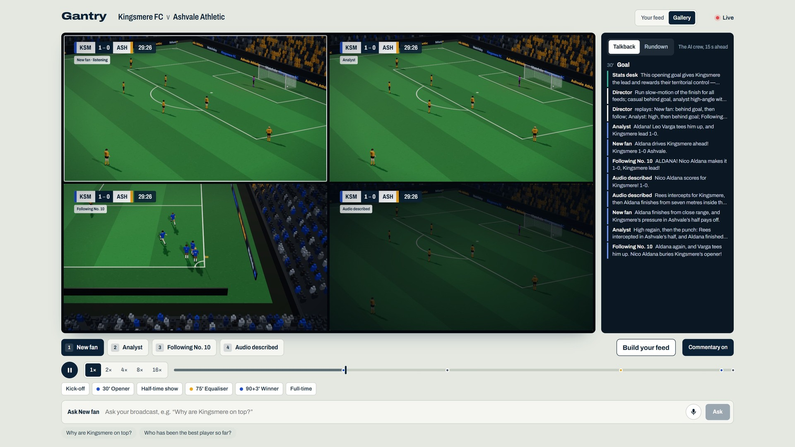
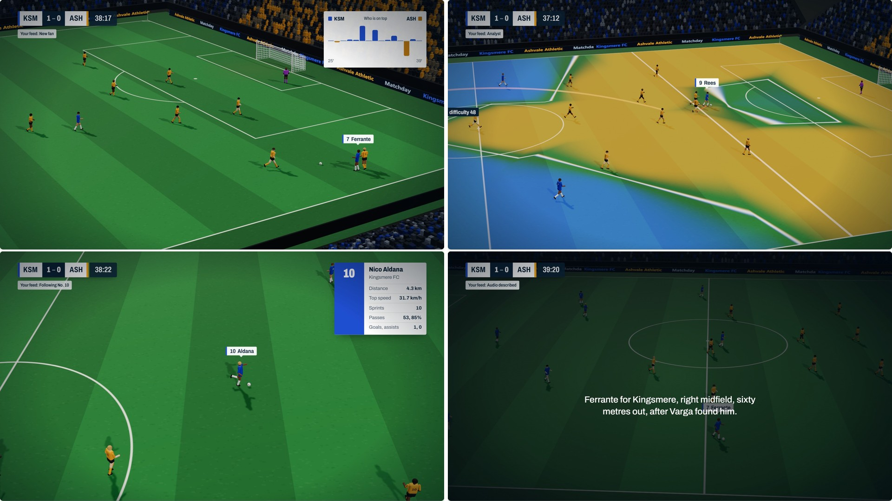
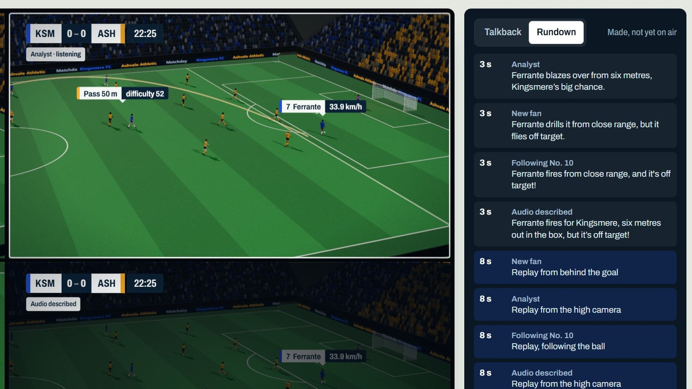

# Gantry

**One match. One AI production crew. A different broadcast for every fan.**

Gantry is an AI production crew for football broadcasts. It watches a synthetic match through full player
tracking, works out what matters from the numbers, and produces a separate live broadcast for each kind of
viewer, each with its own commentary, voice, camera, graphics, replays and language. Everything is timed to
the picture as a machine-readable rundown. The crew is built with **Microsoft Agent Framework**, runs on
**Microsoft Foundry** models, speaks through **Azure AI Speech**, and is served from **Azure Container Apps**.



**[Watch the video](https://youtu.be/vPupkhUmb2c)** (under two minutes) or **[try the live demo](https://gantry.salmondune-004c8a8a.eastus2.azurecontainerapps.io)**.

---

## Try it in two minutes

1. Open the [demo](https://gantry.salmondune-004c8a8a.eastus2.azurecontainerapps.io) and press
   **Watch the first goal, with sound**. The gallery opens a few seconds before Nico Aldana's goal. All four
   broadcasts call it at the same moment, then each shows its own replays.
2. Click any monitor to hear it. Put headphones on for **Audio described**: the voice moves left and right
   with the ball.
3. **Ask your broadcast**: type a question, press **V** and speak, or click a suggested question.
4. **Build your feed**: for example, an Ashvale fan following Tobi Adekunle, in Spanish, who cares about pace.
   The crew starts producing it live, alongside the others.
5. Use the chapters to jump to the **Half-time show** or the **90+3' Winner**.
6. In the gallery, open the **Rundown** tab to see what the crew has already made that viewers have not yet seen.

## Who it is for

A rights holder carries one match to millions of people who want different things from it. Today they get a
handful of commentary tracks, made by people who are scarce. Gantry's crew makes as many broadcasts as there
are audiences, live, from the same match data.

| Broadcast | Who it's for | What changes |
|---|---|---|
| **New fan** | people new to football | plain words, why a moment matters, a rule explained when it comes up |
| **Analyst** | data-minded fans, coaches | the mechanism and the numbers: pressing, space, pass difficulty, xG, the defensive line |
| **Following No. 10** | Kingsmere supporters | a camera that stays with Nico Aldana, his numbers, a partisan voice |
| **Audio described** | blind and partially sighted fans | where the ball is, who has it, which way they attack; the voice follows the ball across the stereo field |
| **Your own feed** | anyone | any of the four styles, either club, any player to follow, the one number you care about, in any of eight languages |



**Eight languages**: English, Spanish, Portuguese, French, Arabic, Hindi, Indonesian and Chinese. A feed in
another language is entirely in that language: words, voice, graphics, and player and club names in the
language's own script. The page around it stays in English.

## The AI production crew

The crew is organised like a real broadcast team. Each role is an executor in a Microsoft Agent Framework
workflow, and the feeds are written in parallel, each by its own agent:


| Role | Does | How |
|---|---|---|
| **Stats desk** | finds the moments worth covering and says why they matter | detection in code; an agent with tools over the match statistics writes the explanation |
| **Director** | decides, feed by feed, who speaks, what about, which graphic, which replay angle; sends a line back when it breaks house rules | an agent returning a structured plan, with its own rules when the model is slow |
| **Commentators** | write each line in the feed's language, style and point of view | one agent per feed, run in parallel through a multi-selection edge |
| **Voices** | read each line in the feed's own voice and book it into that feed's rundown | Azure AI Speech neural voices, eighteen across eight languages |
| **Editor** | cuts the half-time and full-time highlights and writes each feed's report | its own workflow, alongside the live crew |
| **Producer** | answers viewers' questions, with a replay of the moment | an agent with tools that only see what the viewer has already seen |

**How a goal is covered.** The crew works 15 seconds ahead of the picture, like a broadcast delay. When the
stats desk sees a goal coming, the director keeps the air clear around it on every feed. Two workflow runs
then start at once: the *call*, which goes straight to the commentators so each feed calls the goal as it
happens, and the *analysis*, which waits for the stats desk and the director and goes out over the replay.
Each feed gets its own replay angle, then a second one. In the demo match every goal is called within
0.3 seconds of the ball crossing the line, on all four feeds.

**Shared booth.** The crew shares one picture of what is on air: every feed's booked lines, the air kept for
big moments, the storylines each feed has already told. Bookings, cards and substitutions are never dropped;
when the air is busy they wait for the next gap.

**House rules.** Every commentator works to the same rules: only names and numbers from the facts, every
player in the right team, numbers said the way they are said aloud. The director reads each line before it
goes out and sends it back once if it breaks a rule; if there is no time, a prepared line in the feed's
language goes out instead.

**When things go wrong the show goes on.** Every model call has a deadline. A slow director falls back to its
rules, a slow commentator to a prepared line, a stalled voice to captions, a moment that takes too long is
dropped rather than allowed to hold up the next. A crew failure never takes the picture down.

## What the numbers say

Everything said as a number is computed in code from the tracking data (10 frames a second, 22 players and the
ball) and the events: speed and sprints, distance, pass difficulty, shot speed and xG, PPDA, the share of
final-third passes, attack momentum, control or chaos, which team would reach each patch of grass first, and
how high each team's back four is holding. From these the stats desk builds **storylines**: a goalkeeper who
keeps being called on, a striker still waiting for a goal, a substitute changing a game, a back line dropping
deeper.

A **synthetic season** gives the match its context: a fictional 20-club league, nine matchdays played,
the table, each club's form, the last meeting and players' season numbers. It is how the crew knows that
Aldana's goal is his fiftieth for the club, that Bankole's winner is his first of the season, and that the
result takes Kingsmere top.

## Machine-readable output

The crew's output is a rundown: timed cues for lines, graphics, replays and highlights packages, which a
graphics or playout system can render in sync with the match. In the gallery, the **Rundown** tab shows what the
crew has already made and the viewer hasn't seen yet: here, three seconds before Ferrante's shot, every feed's
call and its replay angle.



```text
GET /api/matches/demo/rundown?feeds=casual_en,analyst_en      every cue, in match time (ticks = tenths of a second)
GET /api/matches/demo/captions/audio_en.vtt                   one feed's commentary as WebVTT captions
```

```json
{"id": "l-casual_en-goal-17585-call", "feed": "casual_en", "tick": 17588, "kind": "line", "moment": "goal",
 "text": "Aldana! Kingsmere lead, and the opening goal is theirs.", "audio": "…", "seconds": 3.1,
 "excited": true, "interrupt": true, "source": "ai"}
```

## Match intelligence over MCP

Gantry serves its match intelligence as an MCP server at `/mcp`, so any AI assistant can plug into the match:
a studio analyst's assistant, a partner's app, or GitHub Copilot in VS Code (`.vscode/mcp.json` is set up for
it). Tools: `match_state`, `key_moments`, `player_stats`, `storylines`, `what_the_crew_said` and
`ask_the_crew`, each looking from a given minute and never beyond it.

```text
> uv run python examples/studio_assistant.py "Who is controlling the game right now, and why?" 72
  -> match_state(minute='72')
  -> storylines(minute='72')
Looked from minute 72. Kingsmere are controlling the game: they have 72% of final-third passes, more shots
(12–5) and higher xG (3.5–1.5), and lower PPDA (6.4) showing stronger pressing. They've also won the ball
back in Ashvale's half 15 times in the last 10 minutes, keeping the pressure on.
```

The assistant is an Agent Framework agent that knows nothing about Gantry: everything it says comes from
Gantry's tools.

## Microsoft technologies

| | What it does in Gantry |
|---|---|
| **Microsoft Foundry** | The models: gpt-5.4-mini for every line on air, gpt-5-mini for the other roles. Tracing of every moment in Application Insights. |
| **Microsoft Agent Framework** | The crew and editor workflows: typed messages, parallel commentators, tools, structured output. The MCP client in the studio assistant. |
| **Azure AI Speech** | 18 neural voices in eight languages, and speech to text for spoken questions. |
| **Azure Container Apps** | One container for the page, the live stream, the rundown API and the MCP server (`infra/main.bicep`). |
| **Microsoft Entra ID** | A managed identity in Azure and the Azure CLI login locally. No keys anywhere. |
| **GitHub Actions** | Lint, tests, front-end build and the container image on every push. |

## Synthetic data

There is no real data anywhere in Gantry. The match comes from a simulator written for it:

- **Engine** (Python, NumPy): two fictional clubs, Kingsmere FC and Ashvale Athletic, in 4-3-3 and 4-2-3-1.
  Team shape, pressing and screening, man-marking near goal, runs in behind, recovery runs, tackles, fouls, set
  pieces, substitutions and fatigue. Every on-ball choice is scored as *how likely it is to work* × *how
  dangerous the place it gets us*.
- **Story director**: for the demo, a script shapes each side's tactics and decides in which windows a shot may
  go in. Every pass, tackle and shot is still played out by the engine. The demo match (seed 60) finishes
  Kingsmere 2–1 Ashvale: Aldana 30', Adekunle 75', Bankole 90+3'.
- **Season**: `gantry.sim.season` builds the fictional league around the match.
- **Data**: 57,601 frames of tracking data and about 3,600 events, in `backend/data/matches/demo`.

## Run it locally

You need Python 3.12+ with [uv](https://docs.astral.sh/uv/) and Node 22.

```bash
cd backend && uv sync && uv run uvicorn gantry.server:app --port 8000
cd frontend && npm install && npx vite            # open http://localhost:5173
```

The produced broadcast (every line, voice and package the crew made for the demo match) is a release asset, not in
the repository. With it unpacked into `backend/data/productions`, the broadcast plays with nothing else set up:

```bash
gh release download --repo narmi924/gantry --pattern gantry-demo-production.zip
unzip gantry-demo-production.zip -d backend/data/productions
```

To run the crew live (questions, your own feed, new languages) you also need the Azure CLI and a Microsoft
Foundry project with `gpt-5.4-mini` and `gpt-5-mini` deployments:

```bash
az login
cp backend/.env.example backend/.env                       # your Foundry resource's endpoints
uv run python -m gantry.crew.produce --id demo             # produce the whole broadcast ahead of time
uv run python -m gantry.sim.generate --id demo --seed 60   # play the demo match again
uv run pytest                                              # the tests, no Azure needed
```

Keys: **1–5** switch feed, **G** gallery, **M** commentary on or off, **V** ask by voice, **S** data panel,
**T** tactical camera, **Space** pause. `?minute=29` opens the match at a minute.

## Known limitations

- The simulator is a simplified model of football, and in the demo match the scoreline is scripted.
- New Azure subscriptions get no quota for the newest models, so the crew runs on mini models.
- In the gallery all feeds share one 3D scene, so they go to a replay together, each from its own angle.
- The audio-described feed has been tested with synthetic speech, not yet with blind and partially sighted fans.
- The crowd sound is synthesised in the browser; there are no recordings.
- Built for desktop browsers.

## License

MIT, see [LICENSE](LICENSE). All clubs, players and data are fictional.
